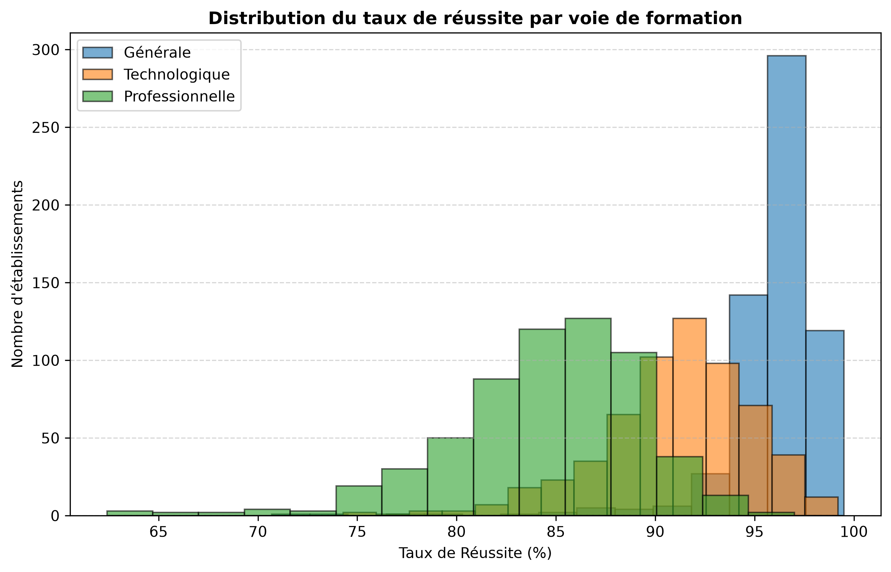
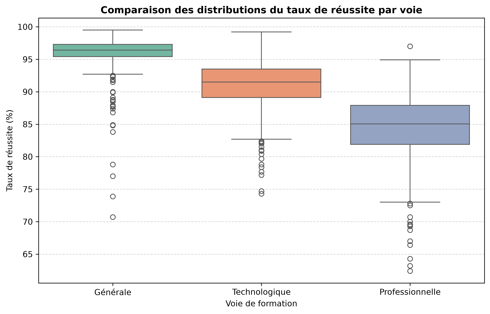
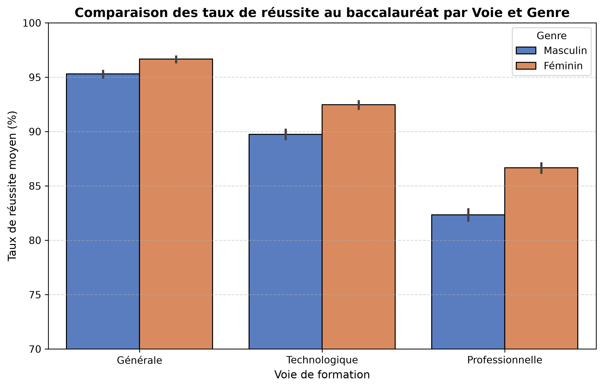

# 📊 Analyse Statistique de la Réussite au Baccalauréat en France

## 📌 Présentation du Projet
Ce projet propose une analyse exploratoire des données et une étude statistique des taux de réussite au baccalauréat français par département. L'objectif est d'identifier les disparités de réussite à l'échelle nationale et de comprendre l'impact des facteurs géographiques et des voies de formation sur les résultats.

## 🛠️ Stack Technique
* **Langage :** Python 3
* **Librairies :** Pandas (Manipulation), NumPy (Calcul), SciPy (Statistiques), Matplotlib & Seaborn (Visualisation)

## 🔍 Découvertes Majeures & Storytelling

### 1. Segmentation nette par Voie de formation
La voie de formation est le premier facteur discriminant de la réussite. La voie générale présente un effet de plafond avec une concentration des établissements au-dessus de 95% de réussite. À l'inverse, la voie professionnelle affiche une dispersion beaucoup plus grande et des performances globales inférieures.

Voici la distribution des taux de réussite observée :

### 2. Analyse des Outliers : L'impact insulaire et l'effet banlieue
En appliquant la méthode de l'Écart Interquartile (IQR), l'algorithme a identifié une multitude d'établissements hors-normes (outliers inférieurs), visibles sous forme de points isolés sous les trois boîtes. 

L'analyse croisée de ces points avec nos agrégations départementales révèle deux réalités distinctes :

* **L'isolement insulaire (Les outliers extrêmes) :** Les points situés au niveau le plus bas du graphique (sous la barre des 66% pour la voie professionnelle) matérialisent un décrochage unique. Après vérification dans le dataset, ce signal statistique strict correspond exclusivement à des lycées professionnels des territoires ultramarins (Mayotte et la Guyane se classant d'ailleurs en queue de peloton national).
* **Le facteur grande couronne (Les outliers intermédiaires) :** La longue traînée de points sous les filières générale et technologique (s'étalant de 70% à 85%) montre un phénomène de masse. En recoupant ces points avec notre classement par département, on constate qu'il s'agit principalement des lycées de la banlieue parisienne (93, 95, 91, 77), qui trustent le bas du classement de la France métropolitaine.

* **La "Success Story" (L'outlier supérieur de la voie pro) :** À l'inverse, le graphique met en évidence un point isolé unique tout en haut de la filière professionnelle, atteignant un taux de réussite exceptionnel (>96%). L'analyse de la variable qualitative révèle qu'il s'agit d'un établissement de l'**Académie de Toulouse**. Ce signal isole l'impact des filières pro industrielles et aéronautiques de pointe de la région toulousaine. Très sélectives et connectées à un tissu économique fort (Airbus et ses sous-traitants), ces structures parviennent graphiquement à égaler, voire dépasser, les standards de performance de la voie générale.

Ces observations sont matérialisées par les points isolés tout en bas du Boxplot ci-dessous :

### 3. Analyse croisée par Sexe : Une disparité de genre marquée dans les filières courtes

L'introduction de la variable de genre confirme une tendance structurelle : les filles surperforment les garçons dans les trois voies de formation. Néanmoins, l'intensité de cet écart varie fortement selon les filières :

* **Voie Générale :** L'écart est marginal (~1,4 point), l'excellent niveau global de la filière créant une homogénéisation des performances vers le haut.
* **Voie Professionnelle :** À l'inverse, c'est dans la filière professionnelle que la fracture de genre est la plus prononcée. Les garçons y affichent le taux de réussite le plus bas du jeu de données national (~82,3%), subissant un écart de plus de 4 points par rapport aux filles. 

Ce graphique met en lumière que le décrochage scolaire masculin est fortement corrélé aux filières professionnelles, un signal métier crucial pour les politiques d'orientation éducative.

## 🧼 Méthodologie et Rigueur Statistique
* Nettoyage du dataset (vérification des types, suppression des doublons géographiques, recherche d'outliers).
* Agrégation des données (`groupby`) pour synthétiser un fichier de plusieurs milliers de lignes en 101 entités départementales propres.

* ## 🔮 Perspectives d'évolutions (Backlog)
Pour aller plus loin dans cette étude de l'impact socio-économique sur le système éducatif, les prochaines étapes de ce portfolio seront :
1. **Analyse de cohorte :** Croiser ces résultats avec les taux de réussite au DNB (Brevet) et au CFG par département pour mesurer si le décrochage scolaire s'amorce dès le collège.
2. **Jointure de données :** Intégrer les indices de position sociale (IPS) des établissements pour corréler mathématiquement le niveau de vie des familles avec les trajectoires de réussite.
